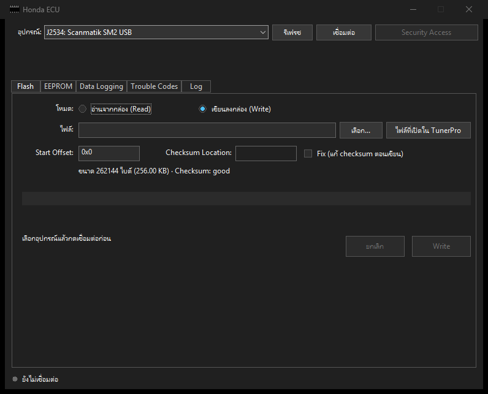
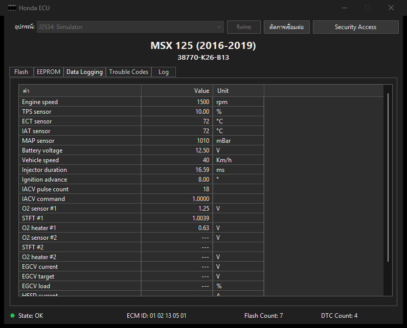

# Honda ECU for TunerPro RT v6

Adds a **Honda ECU** menu to TunerPro. Read and write the ROM, view and write the EEPROM, read trouble codes and watch live data from a Honda ECU over K-Line, all from inside TunerPro. You do not need another program or Python.

Works with FTDI, Scanmatik SM2 and Tactrix OpenPort 2.0 cables, and other 32-bit J2534 cables that support ISO9141.

Ported from HondaECU 3.3.0 by Ryan Hope. Free and open source under GPLv3.

**[Download HondaECU-Setup.exe](https://github.com/AlexDev-TH/TunerPro-HondaECU/releases/latest/download/HondaECU-Setup.exe)**

[All releases](https://github.com/AlexDev-TH/TunerPro-HondaECU/releases) | [ภาษาไทย](README.md) | [ECU table](docs/models.md)



## What it does

- **Read the ROM** and open the file in TunerPro right away
- **Write the ROM**, using the bin that is open in TunerPro
- **EEPROM**: read, write, format and view as hex. Files can be viewed without an ECU
- **Data Logging**: live sensor values such as RPM, TPS, temperatures and battery voltage
- **Trouble Codes**: read and clear
- **Log**: the frames sent to and from the ECU, which you can save to a file

The window follows TunerPro's own theme and language. If TunerPro is dark, the window is dark. If TunerPro shows Thai, including through [tunerpro-thai](https://github.com/AlexDev-TH/tunerpro-thai), the window is in Thai. Otherwise it is in English.

## What you need

1. Windows 10 or 11 (tested by the developer on Windows 11)
2. TunerPro RT v6, from [tunerpro.net](http://www.tunerpro.net). It is not included here
3. A cable and its driver. See [Install the cable driver](#install-the-cable-driver)

Python, the Visual C++ Runtime and other add-ons are not needed.

## Install

1. Save your work and close TunerPro
2. Download [HondaECU-Setup.exe](https://github.com/AlexDev-TH/TunerPro-HondaECU/releases/latest/download/HondaECU-Setup.exe)
3. Double-click the downloaded file
4. Press **Install**
5. When it says the install is done, close the window
6. Open TunerPro. The **Honda ECU** menu is next to the Help menu

The installer copies `HondaECU.dll` to `Documents\TunerPro Files\Plugins`. It does not need administrator rights and does not change any TunerPro file.

### If Windows says "Windows protected your PC"

This file is not signed with a paid certificate, so Windows shows this warning. Press **More info**, then **Run anyway**.

To check the file first, compare its SHA256 with the value on the [Releases](https://github.com/AlexDev-TH/TunerPro-HondaECU/releases) page. Open Command Prompt in the download folder and run:

```
certutil -hashfile HondaECU-Setup.exe SHA256
```

You can also read the code and build it yourself. See [For developers](#for-developers).

### If the Install button is greyed out

TunerPro is still running. Close it. If the button stays grey, look for `TunerPro.exe` in Task Manager.

### Update to a new version

Close TunerPro, download the new installer, open it and press **Reinstall**.

### Uninstall

Close TunerPro, open the installer, press **Uninstall** and then **Yes**.

It removes only `HondaECU.dll` and `HondaECU.log`. Other plug-ins and your bin files are left alone.

### Install by hand

1. Close TunerPro
2. Download `HondaECU.dll` from the [Releases](https://github.com/AlexDev-TH/TunerPro-HondaECU/releases) page
3. Copy it to `Documents\TunerPro Files\Plugins`. Create the folder if it does not exist

To remove it, delete that file.

### Install from a script

```
HondaECU-Setup.exe /install
HondaECU-Setup.exe /uninstall
```

This mode has no window. Check the exit code:

| Exit code | Meaning |
|---|---|
| 0 | Done |
| 1 | Could not write to the Plugins folder |
| 2 | TunerPro is running |

## Install the cable driver

Install only the driver for the cable you use. The plug-in installer does not install drivers.

| Cable | Driver | In the Adapter list it starts with |
|---|---|---|
| FTDI (common FT232R) | FTDI CDM (`ftd2xx.dll`) | `FTDI:` |
| Scanmatik SM2 | Scanmatik J2534 | `J2534:` |
| Tactrix OpenPort 2.0 | Comes with EcuFlash | `J2534:` |
| Other J2534 cable | 32-bit J2534 04.04 driver from the maker | `J2534:` |

### FTDI

1. Get the installer from [FTDI's D2XX page](https://ftdichip.com/drivers/d2xx-drivers/). Choose the Windows setup executable
2. Run it to the end
3. Plug in the cable and press **Refresh** in the Honda ECU window

**If you used the cable with the original HondaECU through Zadig**, change it back to the FTDI driver, because this plug-in does not use libusbK. In Device Manager, right-click the cable, choose Uninstall device and tick the option to remove the driver. Unplug the cable, plug it back in, and install the FTDI driver as above.

### Scanmatik SM2

Install the Scanmatik software and J2534 driver that came with the cable, or ask your seller for them. See the [maker's guide](https://scanmatik.ru/downloads/SM_J2534_RP1210_DPDU_Guide_EN.pdf) for settings.

### Tactrix OpenPort 2.0

Install EcuFlash from [tactrix.com](https://www.tactrix.com/). The J2534 driver comes with that installer.

### Other J2534 cables

You need a 32-bit J2534 04.04 driver, because TunerPro is a 32-bit program, and the cable must support ISO9141. If the driver is registered in Windows correctly, the cable shows up in the list by itself.

> J2534 cables are listed from the Windows registry. Seeing the name means the driver is installed, not that the cable is plugged in. FTDI cables are listed only while plugged in.

## Connect the cable

**FTDI cable**: an FTDI USB to serial adapter plus a serial to K-Line converter. HondaECU recommends a converter with optocouplers to keep bike power away from your computer. See the example at [gonzos.net](https://gonzos.net/projects/ctx-obd).

**J2534 cable**: the cable has an OBD2 plug, so you need an adapter to the bike's connector.

| OBD2 pin | Connect to |
|---|---|
| 7 | K-Line |
| 4 or 5 | Ground |
| 16 | +12V |

For the pins on the bike side, check the service manual for that model.

**ECU on a bench**: use a supply of at least 2.5 A. HondaECU notes that at 2.0 A the ECU powers up, but transfers are slow and you get CRC errors. Power and K-Line pins for some models are in the [ECU table](docs/models.md).

## How to use it

### Connect

1. Connect the cable to the computer and the bike, then turn the key on. Do not start the engine
2. In TunerPro, open the **Honda ECU** menu and choose **Open Honda ECU window**
3. Choose your cable under **Adapter**. Press **Refresh** if you just plugged it in or installed the driver
4. Press **Connect**

The ECU state shows at the bottom.

| State | Meaning | What you can do |
|---|---|---|
| OK | ECU running normally | Write ROM, Data Logging, Trouble Codes |
| SECURE | Security Access is open | Read ROM, EEPROM work |
| FLASH | ECU is in write mode | Write ROM |
| RECOVER_OLD, RECOVER_NEW | A previous write did not finish | Write the ROM again to recover |
| UNKNOWN | The state cannot be determined | Turn the key off and on |
| OFF | ECU does not answer | Turn the key on, check the cable |

The Honda ECU menu:

| Menu item | Goes to |
|---|---|
| Read from ECU | Flash tab, read mode |
| Write to ECU | Flash tab, write mode, with the open bin filled in |
| EEPROM (read / write / view) | EEPROM tab |
| Data Logging | Data Logging tab |
| Trouble Codes | Trouble Codes tab |
| Open Honda ECU window | The main window |

### Security Access

You need this before reading the ROM or doing EEPROM work.

1. Connect until the state is OK
2. Press **Security Access**. The 14-byte password from HondaECU is already filled in
3. Press **OK**
4. When the window says to turn the ECU off, turn the key off
5. When the window says to turn the ECU on, turn the key on. The password is sent while the ECU is starting
6. The state changes to SECURE

### Read the ROM

1. Open Security Access so the state is SECURE
2. On the **Flash** tab, choose **Read from ECU**
3. Enter **Start Offset**. It is usually `0x0`, but some ECUs start at `0x4000` or `0x8000`. See the [ECU table](docs/models.md). If the plug-in knows the model, it fills this in
4. Press **Read** and choose where to save the file
5. When it finishes, it asks whether to open the file in TunerPro

It keeps reading until the ECU stops sending data, the same way HondaECU does. The file size therefore comes from where the ECU stopped answering.

**Check two things before you use the file**: the checksum must pass, and the size must match the ROM of that model. If either one fails, the file may be incomplete. Do not write it back to the ECU.

### Write the ROM

1. Always keep your original file. If you changed values in TunerPro, press Save Bin first, because the file on disk is what gets written
2. Make sure the battery is full and the cable is secure
3. Connect until the state is OK, FLASH, RECOVER_OLD or RECOVER_NEW
4. Choose **Write to ECU** in the menu. The bin open in TunerPro is filled in. Press **Browse...** to choose another file
5. Read the line under the file box. If the checksum says good, go on. If not, tick **Fix checksum when writing** and enter **Checksum Location**. If the plug-in knows the model, it fills this in
6. Press **Write**, read the confirmation and press **Yes**
7. Wait for the message that the write is complete. Turn the key off, wait a moment and turn it on

Fix changes only the data sent to the ECU, not your file. The file size must be a multiple of 64. The window cannot be closed during a write.

**If the write fails**, follow the message. If the ECU was not erased yet, turn the key off, wait a moment, turn it on and try again right away. If the write stopped partway, press write again until it succeeds.

### EEPROM

Security Access is needed for everything except viewing a file.

- **Read**: shows the data as hex and saves it to a file
- **Write**: needs a file of 256 or 512 bytes
- **Format**: fills everything with `0x00` or `0xFF`. The old data is lost, so read a copy first
- **View file**: shows an EEPROM file as hex with no ECU connected

### Data Logging

Connect until the state is OK and open the **Data Logging** tab. Values update by themselves. A value the ECU does not provide shows a dash.



This picture was taken while testing with the simulated ECU, so the values are not from a real bike. The Simulator entry is not in the released version.

### Trouble Codes

Connect until the state is OK and open the **Trouble Codes** tab to see current and past codes. To clear them, press **Clear Codes** and confirm.

### Log

The **Log** tab shows the frames sent to and from the ECU. Press **Save log** to keep them in a file, which is useful when you report a problem.

## Troubleshooting

**No Honda ECU menu**
Check that `Documents\TunerPro Files\Plugins\HondaECU.dll` exists, then open `HondaECU.log` in the same folder. A normal start has a line with `menu added`. This plug-in was tested with TunerPro RT v6 version 6.0.419. A newer TunerPro may change how plug-ins load, and the plug-in would need an update.

**The Adapter list says no adapter was found**
Install the driver as described in [Install the cable driver](#install-the-cable-driver), plug in the cable and press **Refresh**. J2534 cables need a 32-bit driver.

**"Could not open the adapter"**

| Message | What to do |
|---|---|
| `ftd2xx.dll not found` | Install the FTDI CDM driver |
| `FT_Open failed` | Close other programs using the cable, then unplug it and plug it back in. If you used Zadig, change the driver back first |
| `PassThruOpen failed` | Check the cable is plugged in and close other programs using it, such as EcuFlash |
| `PassThruConnect(ISO9141, 10400) failed` | This cable or driver does not support ISO9141 at 10400 baud |

**The state stays OFF**
Turn the key on and check the wiring. J2534 cables cannot measure the K-Line directly, so OFF on these cables means the ECU did not answer. That can be the key being off or a loose wire. Give it a moment, because the plug-in alternates between two ways of waking the ECU.

**The window says Unknown Model**
The plug-in does not know this ECU code, but it still works. Enter Start Offset and Checksum Location yourself.

**The read has a bad checksum or the file is smaller than expected**
The file may be incomplete. Do not write it back. Check the Start Offset for that model and read again. On a bench, check that your supply gives at least 2.5 A.

**The Write button is greyed out**
Read the message to the left of the button. It says what is missing, such as a bad checksum, a file size that is not a multiple of 64, or an ECU state that is not ready.

**The window is in English and I want Thai**
The language follows TunerPro. Install [tunerpro-thai](https://github.com/AlexDev-TH/tunerpro-thai) for Thai.

Still stuck? Open a report under [Issues](https://github.com/AlexDev-TH/TunerPro-HondaECU/issues). Include the bike model, ECU code, cable, the steps you took, and the file saved from the Log tab. Do not attach files that belong to someone else without permission.

## Warnings

**A ROM write that stops partway leaves the ECU unable to start until a write succeeds.** The battery must be full. Do not turn the key off or unplug the cable during a write. Always keep your original file. This software comes with no warranty. Use it at your own risk.

**Test status of version 1.0.0**: the developer has tested it on real hardware and it works. The automated test suite also passes for both FTDI and J2534 against a simulated ECU. It runs in TunerPro RT v6 version 6.0.419 on Windows 11. ECU models may answer differently, so if yours has not been tried yet, test on a spare ECU on a bench first if you can.

## What differs from the original HondaECU

The same: commands, the order of steps, ECU states, retry and timeout values, the Security Access password and the ECU table.

Changed or added:

- **J2534 support** in `src/adapter_j2534.cpp`. It is only a transport, and the code above it does not know which cable is in use
- **`write_eeprom` fix**: the original sends `byts[i:i+2]`, but the read stores 2 bytes per word, so the data would shift. This plug-in uses `byts[i*2:i*2+2]`
- **D2XX instead of pyftdi**, because this is C++ running inside the 32-bit TunerPro
- **Code order restored**: `eculib/honda.py` in the 3.3.0 package is decompiled with scrambled indentation, so the checks in `send_command` and `detect_ecu_state` were put back in order
- **Endless checksum error loop removed**: it now counts as one attempt
- **EEPROM tab** shows data as hex and can view files with no ECU connected
- **Not ported**: `.htf` files and the HRC Settings page, which is disabled in the original

Waking the K-Line through J2534 uses `FAST_INIT` with `TINIL=70` and `TWUP=200` to match `HondaECU.init()`. If the ECU does not answer, the next attempt sends 80 zero bytes at 10400 baud, which holds K low for about 77 ms. The two methods alternate until the ECU answers.

## For developers

### Build

You need Visual Studio with Desktop development with C++.

```
build.bat
```

This creates `dist\HondaECU.dll` and `dist\HondaECU-Setup.exe`. The installer is compiled with the `csc.exe` that comes with Windows.

### Test

```
build_tests.bat
```

The tests do not touch hardware. They use a fake `ftd2xx.dll` and a fake J2534 DLL connected to a simulated ECU (`tests/sim_ecu.h`), and run through all the real classes. They cover ROM read and write, EEPROM, Security Access, DTC, Data, recovery modes, 64-byte blocks and J2534 drivers that behave differently.

`tests/golden.inc` holds the command frames extracted from the HondaECU Python source by `tools/gen_golden.py`, to check that the C++ sends the same bytes as the original. With the HondaECU source and Python 3, you can create it again:

```
build_tests.bat <HondaECU source folder>
```

The simulated ECU is built from what the HondaECU code expects. It shows the port matches the original, but it cannot show that a real ECU answers the same way in every case.

### Layout

| File | Purpose |
|---|---|
| `src/plugin.cpp` | Plug-in entry points, the menu, finding the bin open in TunerPro |
| `src/ui.cpp` | The Honda ECU window |
| `src/kline_worker.cpp` | Read, write and state work, ported from `threads/kline.py` |
| `src/honda_ecu.cpp` | ECU protocol, ported from `eculib/honda.py` |
| `src/adapter_ftdi.cpp` | FTDI cable |
| `src/adapter_j2534.cpp` | J2534 cable |
| `installer/Setup.cs` | The installer |
| `tests/` | Tests and the simulated ECU |
| `tools/` | Scripts that generate the ECU table and reference frames from the Python source |

### How the plug-in gets into TunerPro

TunerPro has no public SDK. The vtable in `src/plugin.cpp` comes from reverse engineering the plug-in loader of TunerPro RT v6 version 6.0.419. If a newer version changes the interface, this needs checking again.

The plug-in does not register as a data acquisition interface. TunerPro loads it, and the plug-in adds its menu to the main window.

TunerPro has a hook on its UI thread that themes every window receiving `WM_INITDIALOG`, along with its child controls. So every window in the plug-in is a real dialog whose controls exist before `WM_INITDIALOG` returns. The window code must not answer `WM_CTLCOLOR*`, or it would fight the theme.

The Plugins folder is shared with TunerPro RT 5. Version 5.00 loads the plug-in and shows the menu, but real use was tested only on v6.

## Credits and license

- The protocol, the order of steps, the ECU table and the window layout are ported from **HondaECU 3.3.0** by **Ryan Hope**, released under GPLv3. Ported and changed in November 2026. The changes are listed under [What differs from the original HondaECU](#what-differs-from-the-original-hondaecu)
- At the time of writing, Ryan Hope's original repository cannot be reached. Older code history is still at [roccofz1/HondaECU](https://github.com/roccofz1/HondaECU)
- This project is therefore also released under the **GNU GPL v3**. See [LICENSE](LICENSE)
- TunerPro is copyright Mark Mansur and Creational Technologies, LLC. This project is not connected with the TunerPro developer and includes none of its files
- Honda is a trademark of its owner. This project is not connected with Honda
