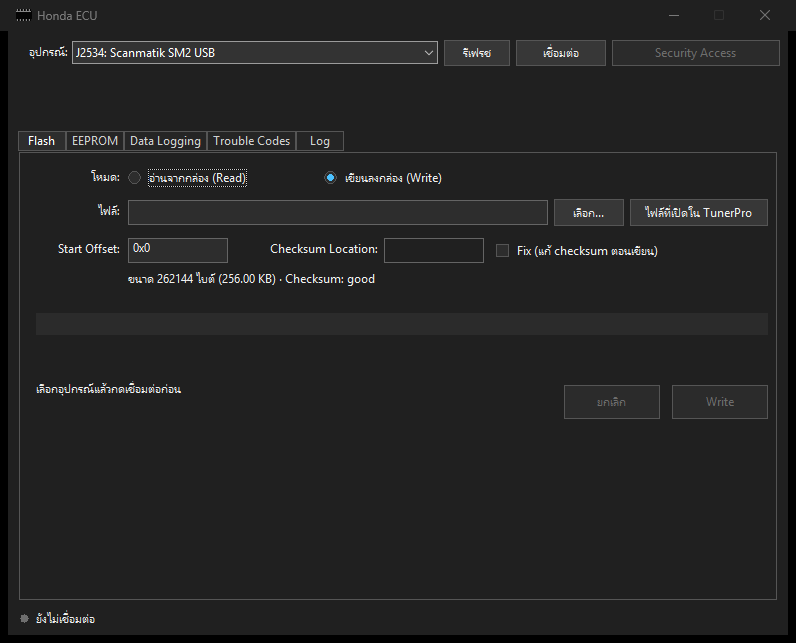
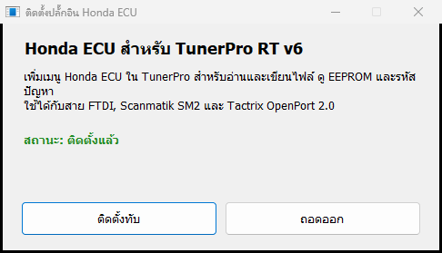
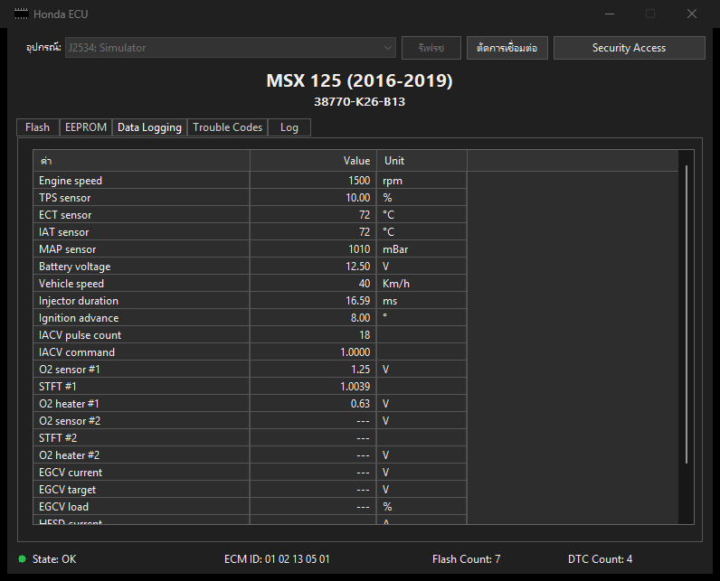

# Honda ECU สำหรับ TunerPro RT v6

เพิ่มเมนู **Honda ECU** เข้าไปใน TunerPro ใช้อ่านและเขียน ROM ดูและเขียน EEPROM อ่านรหัสปัญหา และดูข้อมูลสดของกล่อง Honda ผ่าน K-Line ได้จากในโปรแกรมเลย ไม่ต้องเปิดโปรแกรมอื่น และไม่ต้องลง Python

ใช้ได้กับสาย FTDI, Scanmatik SM2, Tactrix OpenPort 2.0 และสาย J2534 แบบ 32 บิตรุ่นอื่นที่รองรับ ISO9141

พอร์ตมาจาก HondaECU 3.3.0 ของ Ryan Hope แจกฟรีและเปิดซอร์สแบบ GPLv3

**[โหลดตัวติดตั้ง HondaECU-Setup.exe](https://github.com/AlexDev-TH/TunerPro-HondaECU/releases/latest/download/HondaECU-Setup.exe)**

[รุ่นทั้งหมด](https://github.com/AlexDev-TH/TunerPro-HondaECU/releases) | [English](README.en.md) | [ตารางรุ่นกล่อง](docs/models.md)



## สารบัญ

- [ทำอะไรได้บ้าง](#ทำอะไรได้บ้าง)
- [ต้องมีอะไรก่อน](#ต้องมีอะไรก่อน)
- [วิธีติดตั้ง](#วิธีติดตั้ง)
- [ลงไดรเวอร์สาย](#ลงไดรเวอร์สาย)
- [ต่อสาย](#ต่อสาย)
- [วิธีใช้](#วิธีใช้)
- [แก้ปัญหา](#แก้ปัญหา)
- [ข้อควรระวัง](#ข้อควรระวัง)
- [ต่างจาก HondaECU ต้นฉบับตรงไหน](#ต่างจาก-hondaecu-ต้นฉบับตรงไหน)
- [สำหรับนักพัฒนา](#สำหรับนักพัฒนา)
- [เครดิตและลิขสิทธิ์](#เครดิตและลิขสิทธิ์)

## ทำอะไรได้บ้าง

- **อ่าน ROM** จากกล่อง แล้วเปิดไฟล์ใน TunerPro ได้ทันที
- **เขียน ROM** ลงกล่อง โดยดึงไฟล์ที่เปิดอยู่ใน TunerPro มาให้เอง
- **EEPROM** อ่าน เขียน ล้าง และดูเป็น hex ได้ เปิดไฟล์ดูได้โดยไม่ต้องต่อกล่อง
- **Data Logging** ดูค่าเซนเซอร์สด เช่น รอบ TPS อุณหภูมิ แรงดันแบต
- **Trouble Codes** อ่านและล้างรหัสปัญหา
- **Log** ดูเฟรมที่รับส่งกับกล่อง และบันทึกเป็นไฟล์ได้

หน้าต่างใช้ธีมและภาษาตาม TunerPro เอง ถ้า TunerPro เป็นธีมมืด หน้าต่างก็มืด ถ้า TunerPro แสดงภาษาไทย (รวมถึงที่ลงด้วย [tunerpro-thai](https://github.com/AlexDev-TH/tunerpro-thai)) หน้าต่างก็เป็นไทย นอกนั้นเป็นอังกฤษ

## ต้องมีอะไรก่อน

1. Windows 10 หรือ 11 (ผู้พัฒนาทดสอบบน Windows 11)
2. TunerPro RT v6 หน้านี้ไม่ได้แจกตัวโปรแกรม โหลดได้จาก [tunerpro.net](http://www.tunerpro.net)
3. สายและไดรเวอร์ของสาย ดูหัวข้อ [ลงไดรเวอร์สาย](#ลงไดรเวอร์สาย)

ไม่ต้องลง Python, Visual C++ Runtime หรือโปรแกรมเสริมอื่น

## วิธีติดตั้ง

1. บันทึกงานแล้วปิด TunerPro
2. โหลดไฟล์ [HondaECU-Setup.exe](https://github.com/AlexDev-TH/TunerPro-HondaECU/releases/latest/download/HondaECU-Setup.exe)
3. ดับเบิลคลิกไฟล์ที่โหลดมา
4. กดปุ่ม **ติดตั้ง**
5. พอขึ้นว่าติดตั้งเรียบร้อย ก็ปิดหน้าต่างได้
6. เปิด TunerPro จะเห็นเมนู **Honda ECU** อยู่ข้างเมนูช่วยเหลือ




ตัวติดตั้งแค่คัดลอก `HondaECU.dll` ไปไว้ที่ `Documents\TunerPro Files\Plugins` ไม่ต้องใช้สิทธิ์แอดมิน และไม่แก้ไฟล์ของ TunerPro

### ถ้า Windows ขึ้นว่า Windows protected your PC

ไฟล์นี้ยังไม่ได้ซื้อใบรับรองของ Microsoft เลยขึ้นเตือนแบบนี้ ให้กด **More info** แล้วกด **Run anyway**

ถ้าไม่สบายใจ เทียบค่า SHA256 กับที่ลงไว้ในหน้า [Releases](https://github.com/AlexDev-TH/TunerPro-HondaECU/releases) ได้ โดยเปิด Command Prompt ในโฟลเดอร์ที่โหลดไฟล์มาแล้วพิมพ์

```
certutil -hashfile HondaECU-Setup.exe SHA256
```

หรือจะอ่านโค้ดแล้ว build เองก็ได้ ดูหัวข้อ [สำหรับนักพัฒนา](#สำหรับนักพัฒนา)

### ถ้าปุ่มติดตั้งกดไม่ได้

แปลว่า TunerPro ยังเปิดอยู่ ปิดโปรแกรมก่อน ถ้าปิดหน้าต่างแล้วยังกดไม่ได้ ให้ดูใน Task Manager ว่ามี `TunerPro.exe` ค้างอยู่ไหม

### อัปเดตเป็นรุ่นใหม่

ปิด TunerPro โหลดตัวติดตั้งรุ่นใหม่ เปิดแล้วกด **ติดตั้งทับ**

### ถอดออก

ปิด TunerPro เปิดตัวติดตั้งแล้วกด **ถอดออก** จากนั้นกด **Yes**

ตัวติดตั้งจะลบแค่ `HondaECU.dll` กับ `HondaECU.log` ไม่แตะปลั๊กอินตัวอื่น และไม่แตะไฟล์ bin ของคุณ

### ลงเองโดยไม่ใช้ตัวติดตั้ง

1. ปิด TunerPro
2. โหลดไฟล์ `HondaECU.dll` จากหน้า [Releases](https://github.com/AlexDev-TH/TunerPro-HondaECU/releases)
3. คัดลอกไปไว้ที่ `Documents\TunerPro Files\Plugins` ถ้ายังไม่มีโฟลเดอร์นี้ให้สร้างขึ้นมา

จะถอดออกก็ลบไฟล์นั้นทิ้ง

### ลงผ่านสคริปต์

```
HondaECU-Setup.exe /install
HondaECU-Setup.exe /uninstall
```

โหมดนี้ไม่มีหน้าต่าง ผลลัพธ์ดูจาก exit code

| exit code | ความหมาย |
|---|---|
| 0 | สำเร็จ |
| 1 | เขียนไฟล์ในโฟลเดอร์ Plugins ไม่ได้ |
| 2 | TunerPro เปิดอยู่ |

## ลงไดรเวอร์สาย

ลงเฉพาะของสายที่คุณใช้ ตัวติดตั้งของปลั๊กอินไม่ได้ลงไดรเวอร์ให้

| สาย | ไดรเวอร์ | ในช่องอุปกรณ์จะขึ้นต้นว่า |
|---|---|---|
| FTDI (FT232R ทั่วไป) | FTDI CDM (`ftd2xx.dll`) | `FTDI:` |
| Scanmatik SM2 | J2534 ของ Scanmatik | `J2534:` |
| Tactrix OpenPort 2.0 | มากับ EcuFlash | `J2534:` |
| สาย J2534 อื่น | J2534 04.04 แบบ 32 บิต ของผู้ผลิตสาย | `J2534:` |

### FTDI

1. โหลดตัวติดตั้งจาก [หน้า D2XX ของ FTDI](https://ftdichip.com/drivers/d2xx-drivers/) เลือกแบบ Windows setup executable
2. เปิดไฟล์แล้วกดติดตั้งจนจบ
3. เสียบสาย แล้วกด **รีเฟรช** ในหน้าต่าง Honda ECU

**เคยใช้กับ HondaECU ต้นฉบับผ่าน Zadig มาก่อน** ต้องเปลี่ยนกลับเป็นไดรเวอร์ FTDI เพราะปลั๊กอินนี้ไม่ได้คุยผ่าน libusbK ให้เปิด Device Manager คลิกขวาที่สาย เลือก Uninstall device ติ๊กลบไดรเวอร์ แล้วถอดสาย เสียบใหม่ และลงไดรเวอร์ FTDI ตามขั้นตอนข้างบน

### Scanmatik SM2

ลงโปรแกรมและไดรเวอร์ J2534 ของ Scanmatik ที่มากับสายหรือขอจากผู้ขาย รายละเอียดการตั้งค่าดูจาก[คู่มือของผู้ผลิต](https://scanmatik.ru/downloads/SM_J2534_RP1210_DPDU_Guide_EN.pdf)

### Tactrix OpenPort 2.0

ลง EcuFlash จาก [tactrix.com](https://www.tactrix.com/) ไดรเวอร์ J2534 ของสายมากับตัวติดตั้งนั้น

### สาย J2534 รุ่นอื่น

ต้องมีไดรเวอร์ J2534 04.04 แบบ 32 บิต เพราะ TunerPro เป็นโปรแกรม 32 บิต และสายต้องรองรับ ISO9141 ถ้าไดรเวอร์ลงทะเบียนใน Windows ถูกต้อง สายจะขึ้นในรายการเอง

> สาย J2534 ขึ้นในรายการจาก registry ของ Windows เห็นชื่อสายจึงแปลว่าลงไดรเวอร์แล้ว ไม่ได้แปลว่าสายเสียบอยู่ ส่วนสาย FTDI จะขึ้นเฉพาะตอนเสียบอยู่

## ต่อสาย

**สาย FTDI** ต้องเป็นชุด USB เป็น Serial ที่ใช้ชิป FTDI ต่อกับวงจรแปลง Serial เป็น K-Line HondaECU แนะนำวงจรที่ใช้ optocoupler เพื่อแยกไฟรถออกจากคอมพิวเตอร์ ดูตัวอย่างได้ที่ [gonzos.net](https://gonzos.net/projects/ctx-obd)

**สาย J2534** ฝั่งสายเป็นขั้ว OBD2 ต้องมีสายแปลงไปยังขั้วของรถ

| ขา OBD2 | ต่อกับ |
|---|---|
| 7 | K-Line |
| 4 หรือ 5 | กราวด์ |
| 16 | ไฟ +12V |

ตำแหน่งขาฝั่งรถดูจากคู่มือซ่อมของรุ่นนั้น

**ต่อกล่องบนโต๊ะ** ใช้แหล่งจ่ายอย่างน้อย 2.5 A HondaECU ระบุว่าถ้าใช้ 2.0 A กล่องจะติด แต่รับส่งช้าและเจอ CRC error ตำแหน่งขาไฟกับ K-Line ของบางรุ่นอยู่ใน[ตารางรุ่นกล่อง](docs/models.md)

## วิธีใช้

ปุ่มในหน้าต่างเป็นภาษาเดียวกับ TunerPro ถ้า TunerPro เป็นอังกฤษ ดูชื่อปุ่มได้จาก [README ภาษาอังกฤษ](README.en.md)

### เชื่อมต่อ

1. ต่อสายเข้าคอมพิวเตอร์และรถ แล้วเปิดกุญแจ ไม่ต้องสตาร์ท
2. ใน TunerPro กดเมนู **Honda ECU** แล้วเลือก **เปิดหน้าต่าง Honda ECU**
3. เลือกสายในช่อง **อุปกรณ์** ถ้าเพิ่งเสียบหรือเพิ่งลงไดรเวอร์ให้กด **รีเฟรช**
4. กด **เชื่อมต่อ**

สถานะกล่องจะขึ้นที่แถบล่าง

| สถานะ | ความหมาย | ทำอะไรได้ |
|---|---|---|
| OK | กล่องทำงานปกติ | เขียน ROM, Data Logging, Trouble Codes |
| SECURE | เข้า Security Access แล้ว | อ่าน ROM, งาน EEPROM |
| FLASH | กล่องอยู่ในโหมดเขียน | เขียน ROM |
| RECOVER_OLD, RECOVER_NEW | เขียนค้างจากรอบก่อน | เขียน ROM ซ้ำเพื่อกู้ |
| UNKNOWN | ระบุสถานะกล่องไม่ได้ | ปิดกุญแจแล้วเปิดใหม่ |
| OFF | กล่องไม่ตอบ | เปิดกุญแจ แล้วเช็กสาย |

รายการในเมนู Honda ECU

| เมนู | ไปที่ |
|---|---|
| อ่านไฟล์จากกล่อง (Read) | แท็บ Flash โหมดอ่าน |
| เขียนไฟล์ลงกล่อง (Write) | แท็บ Flash โหมดเขียน และดึงไฟล์ที่เปิดอยู่มาให้ |
| EEPROM (อ่าน / เขียน / ดู) | แท็บ EEPROM |
| ข้อมูลสด (Data Logging) | แท็บ Data Logging |
| รหัสปัญหา (Trouble Codes) | แท็บ Trouble Codes |
| เปิดหน้าต่าง Honda ECU | หน้าต่างหลัก |

### เข้า Security Access

ต้องทำก่อนอ่าน ROM หรือทำงาน EEPROM

1. เชื่อมต่อให้สถานะเป็น OK
2. กดปุ่ม **Security Access** รหัส 14 ไบต์ของ HondaECU ใส่มาให้แล้ว
3. กด **ตกลง**
4. พอหน้าต่างบอกให้ปิดกุญแจ ก็ปิดกุญแจ
5. พอหน้าต่างบอกให้เปิดกุญแจ ก็เปิดกุญแจ โปรแกรมจะส่งรหัสให้เองตอนกล่องเพิ่งติด
6. สถานะจะเปลี่ยนเป็น SECURE

### อ่าน ROM

1. เข้า Security Access ให้สถานะเป็น SECURE
2. ที่แท็บ **Flash** เลือก **อ่านจากกล่อง (Read)**
3. ใส่ **Start Offset** ปกติคือ `0x0` แต่กล่องบางรุ่นเริ่มที่ `0x4000` หรือ `0x8000` ดูจาก[ตารางรุ่นกล่อง](docs/models.md) ถ้าปลั๊กอินรู้จักรุ่นจะเติมค่าให้เอง
4. กด **Read** แล้วเลือกที่เก็บไฟล์
5. พออ่านจบ โปรแกรมจะถามว่าเปิดไฟล์ใน TunerPro เลยไหม

โปรแกรมอ่านไปเรื่อย ๆ จนกล่องไม่ส่งข้อมูลต่อ ซึ่งเป็นวิธีเดียวกับ HondaECU ขนาดไฟล์จึงมาจากจุดที่กล่องหยุดตอบ

**ก่อนใช้ไฟล์ที่อ่านได้ ให้เช็ก 2 อย่าง** คือ Checksum ต้องผ่าน และขนาดไฟล์ต้องตรงกับ ROM ของรุ่นนั้น ถ้าไม่ผ่านอย่างใดอย่างหนึ่ง ไฟล์อาจไม่ครบ ห้ามเอาไปเขียนกลับลงกล่อง

### เขียน ROM

1. เก็บไฟล์ต้นฉบับไว้ก่อนเสมอ ถ้าแก้ค่าใน TunerPro ให้กด Save Bin ก่อน เพราะไฟล์ที่เขียนคือไฟล์บนดิสก์
2. เช็กว่าแบตเต็มและสายแน่น
3. เชื่อมต่อให้สถานะเป็น OK, FLASH, RECOVER_OLD หรือ RECOVER_NEW
4. กดเมนู **เขียนไฟล์ลงกล่อง (Write)** โปรแกรมจะดึงไฟล์ที่เปิดอยู่ใน TunerPro มาให้ หรือกด **เลือก...** เพื่อเลือกไฟล์อื่น
5. ดูบรรทัดใต้ช่องไฟล์ ถ้า Checksum เป็น good ไปข้อถัดไปได้เลย ถ้าไม่ผ่านให้ติ๊ก **Fix** แล้วใส่ **Checksum Location** ถ้าปลั๊กอินรู้จักรุ่นจะเติมค่าให้เอง
6. กด **Write** อ่านรายละเอียดในหน้าต่างยืนยันแล้วกด **Yes**
7. รอจนขึ้นว่าเขียนสำเร็จ แล้วปิดกุญแจ รอสักครู่ และเปิดใหม่

การ Fix แก้เฉพาะข้อมูลที่ส่งลงกล่อง ไม่ได้แก้ไฟล์ของคุณ ขนาดไฟล์ต้องหารด้วย 64 ลงตัว และระหว่างเขียนปลั๊กอินจะไม่ยอมให้ปิดหน้าต่าง

**ถ้าเขียนไม่สำเร็จ** ให้ทำตามข้อความที่ขึ้น ถ้ากล่องยังไม่ถูกลบ ให้ปิดกุญแจ รอสักครู่ เปิดใหม่แล้วลองอีกครั้งทันที ถ้าเขียนค้างกลางทาง ให้กดเขียนซ้ำจนสำเร็จ

### EEPROM

ต้องเข้า Security Access ก่อน ยกเว้นการเปิดไฟล์ดู

- **อ่าน (Read)** อ่านแล้วแสดงเป็น hex ในหน้าต่าง และเก็บเป็นไฟล์
- **เขียน (Write)** ใช้ไฟล์ขนาด 256 หรือ 512 ไบต์
- **ล้าง (Format)** เติมค่าเป็น `0x00` หรือ `0xFF` ทั้งหมด ข้อมูลเดิมจะหาย ควรอ่านเก็บไว้ก่อน
- **เปิดดูไฟล์** ดูไฟล์ EEPROM เป็น hex ได้โดยไม่ต้องต่อกล่อง

### Data Logging

เชื่อมต่อให้สถานะเป็น OK แล้วเปิดแท็บ **Data Logging** ค่าจะอัปเดตเอง ช่องที่กล่องรุ่นนั้นไม่มีข้อมูลจะเป็นขีด



ภาพนี้ถ่ายตอนทดสอบกับกล่องจำลอง ค่าที่เห็นไม่ใช่ของรถจริง รายการ Simulator ไม่มีในรุ่นที่แจก

### Trouble Codes

เชื่อมต่อให้สถานะเป็น OK แล้วเปิดแท็บ **Trouble Codes** จะเห็นรหัสปัญหาทั้งแบบปัจจุบันและแบบที่เคยเกิด ถ้าต้องการล้างให้กด **Clear Codes** แล้วกดยืนยัน

### Log

แท็บ **Log** แสดงเฟรมที่รับส่งกับกล่อง กด **บันทึก Log** เพื่อเก็บเป็นไฟล์ ใช้แนบตอนแจ้งปัญหาได้

## แก้ปัญหา

**ไม่เห็นเมนู Honda ECU**
ดูว่ามีไฟล์ `Documents\TunerPro Files\Plugins\HondaECU.dll` ไหม แล้วเปิดไฟล์ `HondaECU.log` ในโฟลเดอร์เดียวกัน ถ้าทำงานปกติจะมีบรรทัด `menu added` ปลั๊กอินนี้ทดสอบกับ TunerPro RT v6 รุ่น 6.0.419 ถ้า TunerPro รุ่นใหม่เปลี่ยนการโหลดปลั๊กอิน ปลั๊กอินอาจต้องแก้ตาม

**ช่องอุปกรณ์ขึ้นว่าไม่พบอุปกรณ์**
ลงไดรเวอร์ตามหัวข้อ [ลงไดรเวอร์สาย](#ลงไดรเวอร์สาย) เสียบสาย แล้วกด **รีเฟรช** สาย J2534 ต้องมีไดรเวอร์แบบ 32 บิต

**ขึ้นว่าเปิดอุปกรณ์ไม่สำเร็จ**

| ข้อความ | ทำอย่างไร |
|---|---|
| `ftd2xx.dll not found` | ลงไดรเวอร์ FTDI CDM |
| `FT_Open failed` | ปิดโปรแกรมอื่นที่ใช้สายอยู่ แล้วถอดสาย เสียบใหม่ ถ้าเคยใช้ Zadig ให้เปลี่ยนไดรเวอร์กลับก่อน |
| `PassThruOpen failed` | เช็กว่าเสียบสายอยู่ และปิดโปรแกรมอื่นที่ใช้สาย เช่น EcuFlash |
| `PassThruConnect(ISO9141, 10400) failed` | สายหรือไดรเวอร์รุ่นนี้ไม่รองรับ ISO9141 ที่ 10400 บอด |

**สถานะเป็น OFF ตลอด**
เปิดกุญแจและเช็กการต่อสาย สาย J2534 วัดสาย K-Line โดยตรงไม่ได้ OFF ของสายแบบนี้จึงแปลว่ากล่องไม่ตอบ ซึ่งอาจเป็นกุญแจปิดหรือสายหลุดก็ได้ รอสักครู่ด้วย เพราะโปรแกรมจะลองปลุกกล่องสลับกัน 2 วิธี

**หน้าต่างขึ้นว่า Unknown Model**
ปลั๊กอินไม่รู้จักรหัสกล่องนี้ แต่ยังใช้งานได้ ต้องใส่ Start Offset และ Checksum Location เอง

**อ่านแล้ว Checksum ไม่ผ่าน หรือได้ไฟล์เล็กกว่าที่ควร**
ไฟล์นั้นอาจไม่ครบ ห้ามเอาไปเขียนกลับ เช็ก Start Offset ของรุ่นนั้นแล้วลองอ่านใหม่ ถ้าใช้แหล่งจ่ายบนโต๊ะ ให้เช็กว่าจ่ายได้อย่างน้อย 2.5 A

**ปุ่ม Write กดไม่ได้**
อ่านข้อความทางซ้ายของปุ่ม โปรแกรมจะบอกว่าขาดอะไร เช่น Checksum ไม่ผ่าน ขนาดไฟล์หารด้วย 64 ไม่ลงตัว หรือสถานะกล่องยังไม่พร้อม

**หน้าต่างเป็นภาษาอังกฤษ ทั้งที่อยากได้ไทย**
ภาษาตาม TunerPro ถ้าต้องการไทยให้ลง [tunerpro-thai](https://github.com/AlexDev-TH/tunerpro-thai)

ยังแก้ไม่ได้ เปิดเรื่องที่ [Issues](https://github.com/AlexDev-TH/TunerPro-HondaECU/issues) ได้เลย ช่วยบอกรุ่นรถ รหัสกล่อง สายที่ใช้ ขั้นตอนที่ทำ และแนบไฟล์จากแท็บ Log มาด้วย ห้ามแนบไฟล์ของคนอื่นที่ไม่ได้รับอนุญาต

## ข้อควรระวัง

**การเขียน ROM ที่ขาดกลางทางทำให้กล่องสตาร์ทไม่ติดจนกว่าจะเขียนซ้ำสำเร็จ** แบตเตอรี่ต้องเต็ม ห้ามดับกุญแจและห้ามถอดสายระหว่างเขียน เก็บไฟล์ต้นฉบับไว้เสมอ ซอฟต์แวร์นี้ไม่มีการรับประกัน ใช้งานตามความเสี่ยงของตัวเอง

**สถานะการทดสอบของรุ่น 1.0.0** ผู้พัฒนาทดสอบกับของจริงแล้วใช้งานได้ และชุดทดสอบอัตโนมัติผ่านทั้ง FTDI และ J2534 กับกล่องจำลอง ใช้งานใน TunerPro RT v6 รุ่น 6.0.419 บน Windows 11 กล่องแต่ละรุ่นอาจตอบไม่เหมือนกัน ถ้าเป็นรุ่นที่ยังไม่เคยลอง ควรลองกับกล่องสำรองบนโต๊ะก่อนถ้าทำได้

## ต่างจาก HondaECU ต้นฉบับตรงไหน

เหมือนกัน: คำสั่ง ลำดับขั้นตอน สถานะกล่อง ค่า retry และ timeout รหัส Security Access และตารางรุ่นกล่อง

ที่เปลี่ยนหรือเพิ่ม:

- **เพิ่มการรองรับ J2534** ใน `src/adapter_j2534.cpp` เป็นชั้นส่งข้อมูลอย่างเดียว โค้ดชั้นบนไม่รู้ว่าใช้สายอะไร
- **แก้ `write_eeprom`** ต้นฉบับส่ง `byts[i:i+2]` แต่ตอนอ่านเก็บคำละ 2 ไบต์ ถ้าเขียนตามนั้นข้อมูลจะเลื่อนเพี้ยน ปลั๊กอินนี้ใช้ `byts[i*2:i*2+2]`
- **เปลี่ยน pyftdi เป็น D2XX** เพราะเป็น C++ ที่ทำงานใน TunerPro ซึ่งเป็นโปรแกรม 32 บิต
- **เรียงโค้ดกลับ** ไฟล์ `eculib/honda.py` ในชุด 3.3.0 เป็นโค้ด decompile ที่การย่อหน้าเพี้ยน `send_command` และ `detect_ecu_state` จึงเรียงเงื่อนไขกลับตามลำดับเดิม
- **ตัด checksum error ที่ลูปไม่รู้จบ** นับเป็นความพยายามหนึ่งครั้ง
- **หน้า EEPROM** แสดงข้อมูลเป็น hex ได้ และเปิดไฟล์ดูได้โดยไม่ต้องต่อกล่อง
- **ไม่ได้พอร์ต** ไฟล์ `.htf` และหน้า HRC Settings (ในต้นฉบับหน้านี้ปิดอยู่)

การปลุก K-Line ผ่าน J2534 ใช้ `FAST_INIT` ตั้ง `TINIL=70` และ `TWUP=200` ให้ตรงกับ `HondaECU.init()` ถ้าปลุกแล้วกล่องไม่ตอบ รอบถัดไปจะสลับไปส่งศูนย์ 80 ไบต์ที่ 10400 บอด (K ต่ำประมาณ 77 มิลลิวินาที) แล้วสลับกลับไปมาจนกว่ากล่องจะตอบ

## สำหรับนักพัฒนา

### build เอง

ต้องมี Visual Studio ที่ลงชุด Desktop development with C++

```
build.bat
```

ได้ไฟล์ `dist\HondaECU.dll` และ `dist\HondaECU-Setup.exe` ตัวติดตั้งคอมไพล์ด้วย `csc.exe` ที่มากับ Windows

### ทดสอบ

```
build_tests.bat
```

ชุดทดสอบไม่แตะฮาร์ดแวร์ ใช้ `ftd2xx.dll` และ J2534 DLL ปลอมที่ต่อกับกล่องจำลอง (`tests/sim_ecu.h`) แล้วรันผ่านคลาสจริงทุกชั้น ครอบคลุมการอ่านและเขียน ROM, EEPROM, Security Access, DTC, Data, โหมด recovery, บล็อก 64 ไบต์ และไดรเวอร์ J2534 ที่พฤติกรรมต่างกัน

`tests/golden.inc` เก็บเฟรมคำสั่งที่ดึงจากซอร์ส Python ของ HondaECU ด้วย `tools/gen_golden.py` เพื่อเทียบว่าเฟรมที่ C++ ส่งตรงกับต้นฉบับทุกไบต์ ถ้ามีซอร์ส HondaECU และ Python 3 จะสร้างไฟล์นี้ใหม่ได้ด้วยคำสั่ง

```
build_tests.bat <โฟลเดอร์ซอร์ส HondaECU>
```

กล่องจำลองสร้างจากสิ่งที่โค้ด HondaECU คาดหวัง จึงยืนยันได้ว่าพอร์ตตรงกับต้นฉบับ แต่บอกไม่ได้ว่ากล่องจริงตอบแบบเดียวกันทุกกรณี

### โครงสร้างโค้ด

| ไฟล์ | หน้าที่ |
|---|---|
| `src/plugin.cpp` | จุดเข้าของปลั๊กอิน เมนู และการหาไฟล์ที่เปิดอยู่ใน TunerPro |
| `src/ui.cpp` | หน้าต่าง Honda ECU |
| `src/kline_worker.cpp` | งานอ่าน เขียน และสถานะ พอร์ตจาก `threads/kline.py` |
| `src/honda_ecu.cpp` | โปรโตคอลของกล่อง พอร์ตจาก `eculib/honda.py` |
| `src/adapter_ftdi.cpp` | สาย FTDI |
| `src/adapter_j2534.cpp` | สาย J2534 |
| `installer/Setup.cs` | ตัวติดตั้ง |
| `tests/` | ชุดทดสอบและกล่องจำลอง |
| `tools/` | สคริปต์สร้างตารางรุ่นกล่องและเฟรมอ้างอิงจากซอร์ส Python |

### ปลั๊กอินเข้า TunerPro ได้อย่างไร

TunerPro ไม่มี SDK สาธารณะ ค่า vtable ใน `src/plugin.cpp` ได้จากการ reverse engineering ตัวโหลดปลั๊กอินของ TunerPro RT v6 รุ่น 6.0.419 ถ้ารุ่นใหม่เปลี่ยน interface ต้องตรวจตรงนี้ใหม่

ปลั๊กอินไม่ได้ลงทะเบียนเป็น data acquisition interface แค่ให้ TunerPro โหลด แล้วเพิ่มเมนูเข้าหน้าต่างหลักเอง

TunerPro ติด hook บน UI thread ที่ใส่ธีมให้ทุกหน้าต่างที่ได้รับ `WM_INITDIALOG` พร้อม control ลูก ทุกหน้าต่างในปลั๊กอินจึงเป็น dialog จริง และสร้าง control ก่อน `WM_INITDIALOG` จบ โค้ดส่วนหน้าต่างห้ามตอบ `WM_CTLCOLOR*` เองเพราะจะชนกับธีม

โฟลเดอร์ Plugins ใช้ร่วมกับ TunerPro RT 5 ด้วย รุ่น 5.00 โหลดปลั๊กอินและขึ้นเมนูได้ แต่ทดสอบการใช้งานจริงเฉพาะรุ่น v6

## เครดิตและลิขสิทธิ์

- โปรโตคอล ลำดับขั้นตอน ตารางรุ่นกล่อง และโครงหน้าจอ พอร์ตจาก **HondaECU 3.3.0** ของ **Ryan Hope** ซึ่งเผยแพร่แบบ GPLv3 พอร์ตและแก้ไขเมื่อพฤศจิกายน 2026 รายการที่เปลี่ยนอยู่ในหัวข้อ [ต่างจาก HondaECU ต้นฉบับตรงไหน](#ต่างจาก-hondaecu-ต้นฉบับตรงไหน)
- ตอนเขียนหน้านี้ repo เดิมของ Ryan Hope เข้าไม่ได้แล้ว ประวัติโค้ดรุ่นเก่ายังดูได้ที่ [roccofz1/HondaECU](https://github.com/roccofz1/HondaECU)
- โปรเจกต์นี้จึงเผยแพร่แบบ **GNU GPL v3** เช่นกัน ดู [LICENSE](LICENSE)
- TunerPro เป็นลิขสิทธิ์ของ Mark Mansur และ Creational Technologies, LLC โปรเจกต์นี้ไม่ได้เกี่ยวข้องกับผู้พัฒนา TunerPro และไม่มีไฟล์ของโปรแกรมนั้นอยู่ในนี้
- Honda เป็นเครื่องหมายการค้าของเจ้าของ โปรเจกต์นี้ไม่เกี่ยวข้องกับ Honda
